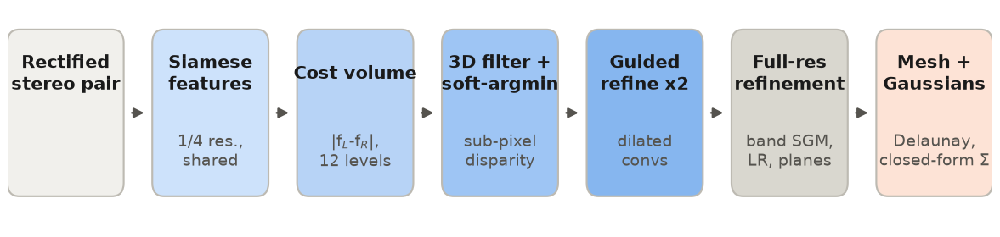
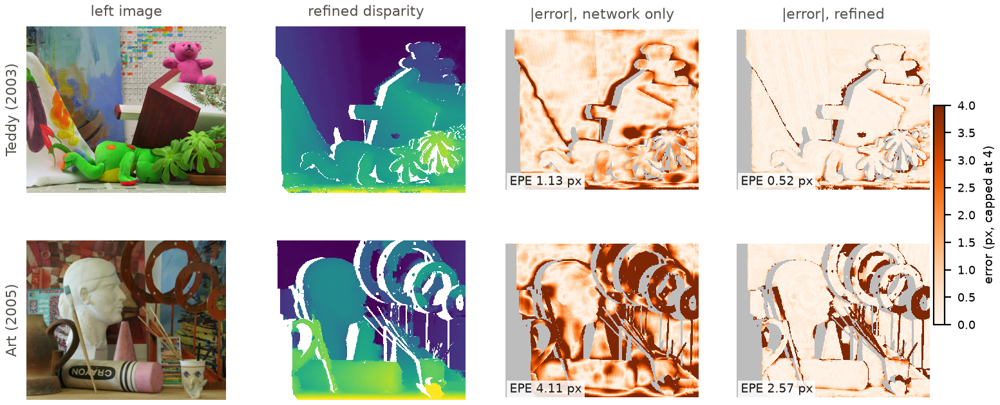
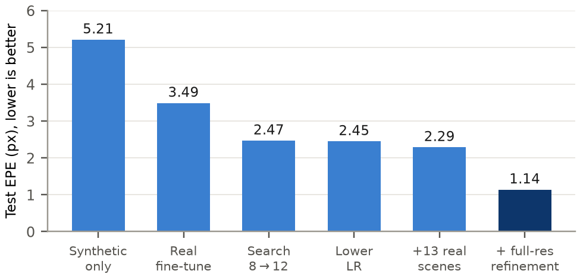

# Stereo from scratch

[](https://doi.org/10.5281/zenodo.23449075)

A stereo-to-3D pipeline written in plain Python with **no import statements**. The repository covers everything from a rectified stereo pair to a textured 3D mesh and Gaussian primitives: PNG decoding, a StereoNet-style network with hand-written backpropagation, full-resolution semi-global matching, Delaunay triangulation, and closed-form Gaussians.

This is the code for the manuscript *From-scratch stereo vision for 3D scene reconstruction with Delaunay triangulation and closed-form Gaussian primitives* (Hameed et al., under review).

Authors: Rayhan Hameed, Yuvan Shankar, Lohith C (Department of Electronics and Communication Engineering, Chennai Institute of Technology) and Nishanthi Rajkamal (Centre for Biomedical Research and Innovation, Chennai Institute of Technology).



| Test set (8 Middlebury scenes) | EPE (px) | bad2 | AbsRel | Normal error | Chamfer |
|---|---|---|---|---|---|
| network alone (9,921 parameters) | 2.29 | 30.0% | 6.07% | 44.7° | 3.22% |
| network + full-resolution refinement | 1.14 | 9.1% | 2.97% | 23.9° | 1.05% |
| census + SGM alone, told the true disparity range | 0.80 | 6.7% | 2.67% | 29.4° | 1.20% |

The last row is a classical control. It is more accurate per pixel. Our pipeline has lower surface-normal error on all 8 scenes and lower Chamfer error on 7 of 8, and it does not need to be told the disparity range. Per-scene numbers are in `scripts/expected_results.json` and in the paper.



*Two held-out test scenes. The refinement removes most of the network's error on Teddy. On Art the network is often more than 10 pixels off, beyond the reach of the ±10-pixel band, and those errors remain.*



*Mean end-point error on the eight test scenes for each configuration that was sent to the test set. Each was chosen on validation first.*

## What "no imports" means

`stereonet.py` (the model) and `test_stereonet.py` (its tests) contain no `import` or `from` line. That excludes NumPy and every deep-learning framework, and also Python's own `math` and `random` modules. One of the 53 tests checks this. Square roots, exponentials, logarithms, random numbers, convolutions, their gradients, the Adam optimiser, a PNG decoder (DEFLATE, zlib, scanline filters), SGM, SLIC, RANSAC, Bowyer-Watson Delaunay and the EWA splat renderer are all implemented in that one file.

The scripts around the model (data download, evaluation tables, 3D metrics, training orchestration) are allowed imports. None of them compute a disparity, a mesh or a Gaussian.

## Quick start

Requires Python 3.9+. [PyPy](https://www.pypy.org/) runs the same code about nine times faster and is recommended.

```bash
# 1. tests (no data needed): gradient checks, PNG round trip, refinement, mesh
pypy3 test_stereonet.py                     # or: python3 test_stereonet.py

# 2. get the Middlebury evaluation data (~16 MB) into ./real
python3 scripts/get_middlebury.py

# 3. reproduce the paper's test numbers and compare them automatically
pip install numpy scipy                     # only for the 3D metrics
python3 scripts/reproduce_test.py           # about 5 minutes with PyPy; prints PASS

# 4. reconstruct your own rectified pair in a local web app
pypy3 serve.py                              # then open http://localhost:8000
```

`web/stereonet_demo.html` is a self-contained browser version. Open it directly; nothing is installed. Its JavaScript port matches the Python network to 4e-14 pixels, and its refinement output is bit-identical (`web/verify.js`, `web/verify_refine.js`).

## Layout

| Path | Contents |
|---|---|
| `stereonet.py` | the whole model and pipeline, zero imports (25 sections, index at the top) |
| `test_stereonet.py` | 53 checks, zero imports |
| `stereonet_weights.txt` | trained network used in the paper (v5); the header records its architecture |
| `weights/` | earlier models from the paper's progression (synthetic-only, real D=8, v4) |
| `eval_real.py` | Middlebury evaluation with the fixed split (`--refine`, `--sgm-only`, `--dump`) |
| `eval3d.py` | 3D metrics: relative depth error, surface-normal error, Chamfer distance |
| `scripts/` | data download, one-command reproduction, expected results |
| `train_parallel.py`, `prep_real.py`, `prep_middeval.py`, `make_dataset.py`, `widen_net.py` | training harness |
| `serve.py` | local web app (standard library only) |
| `web/` | JavaScript port, WebGL viewer, verification scripts, demo page |
| `paper/` | figure script and the GaMeS covariance comparison from the paper |

## Evaluation protocol

The split is fixed by rule. Middlebury 2006 scenes sorted by name, with index mod 4 == 1, form validation (Baby1, Bowling2, Cloth4, Midd1, Rocks1). The other 16 are training. All of 2005 and 2003 is test. MiddEval3 training scenes Teddy and ArtL are excluded from training because they show the same scenes as two test pairs. Every setting was chosen on validation, and the test set was evaluated once. A clean re-run on 2026-10-17 gave bit-identical predictions.

## Retraining

```bash
python3 prep_real.py                                 # needs numpy; real 2006 training scenes
python3 scripts/get_middlebury.py --training
python3 prep_middeval.py data/MiddEval3-data-Q.zip data/MiddEval3-GT0-Q.zip
python3 make_dataset.py train 260 192 128 datasets/wide 22 40   # rendered scenes
pypy3 train_parallel.py 3000 weights/stereonet_v4.txt my_model.txt 5e-4
```

The paper's model went through several stages (see the paper, Table 3). The flags of the original rendered-data run were not recorded, so the `make_dataset.py` line above approximates that set (peak disparities 22 to 39 px). Retraining is therefore not expected to reproduce the weights exactly. The released weights reproduce the evaluation exactly.

## Data

The Middlebury stereo datasets are by D. Scharstein, R. Szeliski, C. Pal, H. Hirschmüller and colleagues: https://vision.middlebury.edu/stereo/data/. They are not included here. `scripts/get_middlebury.py` downloads them from the original site. The demo page embeds three Middlebury pairs (cones, teddy, Art) for illustration. Please cite the Middlebury papers listed in the manuscript if you use the data.

## Citing

See `CITATION.cff`. The release used in the paper (v1.0.0) is archived on Zenodo: https://doi.org/10.5281/zenodo.23449075

## License

MIT, see `LICENSE`.
